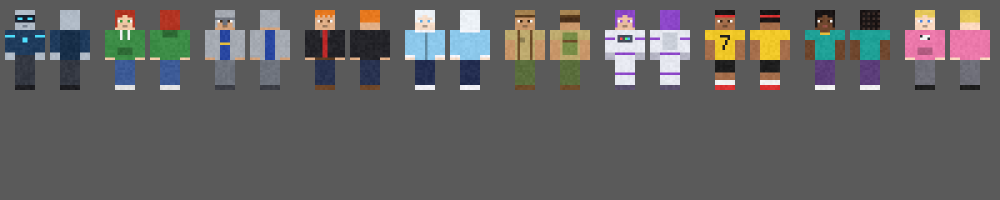

# AI Players — Minecraft Bedrock add-on

An original add-on with AI companions that look like players. It's kept separate from the LeadEmm app.

**Download for iPad:** `dist/AI_Players.mcaddon` · Needs Minecraft 26.40 or newer (made for 26.52).



## What it does (v1.34.1)
- **AI Computer:** every player spawns with one in their hotbar (and gets a new one after dying if it's gone).
  It can't be placed or eaten; use it to see how to craft the Coder and what each AI costs (red until you
  have enough, green when you do), with *More help* for the full guide.
- **Coder** block: the shop. Tap it, pick an AI to read what it does and its price, then buy it.
  ```
  Glass  Glass     Glass
  Iron   Redstone  Iron
  Iron   Iron      Iron
  ```
- Each player buys **one AI, ever**: a **Resource AI** for 30 gold ingots. It then levels up at the Coder (see *Stages*). (Players who bought both AIs in older versions keep them.)
- Prices show in red until you have enough. Trying to buy without enough only tells you how many more you need.
- Buying: type a name (required). The look is picked automatically (add-ons can't copy a player's skin). Every AI starts with full health and 15 cooked chicken. You get an **AI Egg**; use it to throw it,
  and your AI appears where it lands.
- Lost the egg? Open the Coder and pick your AI to get a new one (the old egg stops working).
- **Remote:** when you throw the egg, its hotbar slot gets a Remote (black with green Matrix code; it used to be **red** for the Fighter,
  **blue** for the Resource AI). Use it to teleport your AI to you. If the AI is too far away to be loaded,
  it rejoins next to you with everything it carries. Lost it? The Coder gives you a new one.
- **If an AI dies, it respawns 60 seconds later near the player who bought it** (or its controller).

### Controllers (Remotes)
- Whoever holds an AI's Remote controls it. Drop it and let another player pick it up, and the AI
  rejoins next to them and follows, protects and obeys them, keeping everything it carries.
- Handing over a controller never changes who bought it: the buyer still can't buy another of that kind,
  and the new controller can still buy their own if they haven't yet. **One AI per player:** someone who already controls an AI can hold another player's Remote, but it does nothing for them.

### Mobs and explosions
- Mobs can't hurt either AI, and no explosion can (creepers, ghast fireballs, TNT).
- The Resource AI never fights (it runs from players who attack it). The Fighter kills mobs.

### Stages (level up at the Coder)
| Stage | Cost | What it gets |
|---|---|---|
| 1. Resource AI | 30 gold ingots (buy) | Gathering (Trees, Caves), sugar cane farm, torches, water bucket, AI Chest (locked) |
| 2. Resource AI+ | 10 diamonds | Strip mining (digs a tunnel straight to diamonds, or netherite in the Nether), no lava/fire/fall damage (no potion bubbles), AI Chest unlocked, Computer Chest access |
| 3. Fighter AI | 15 diamonds | Becomes a Fighter and **keeps everything above**: fights mobs and players, guards, fighting styles, arrows, tombstone looting, red Remote. Remote → *Jobs* sends it off to do its old jobs; it drops the work to fight any enemy, then goes back to it. Its tool slots take weapons and mining tools. |
| 4. Fighter AI Max | 10 netherite ingots | The 30-block sequence (below), 2 opening arrows at 3x speed in Bow + Sword |

While an AI is working (gathering, building, guarding) with no player within 40 blocks, it keeps its land loaded with one ticking area so it doesn't freeze. Its ticking areas are removed when it comes back near a player, is deleted, or the world reloads (only ones the add-on made).

### Upgraded Fighter: the 30-block sequence
When an enemy player comes within 30 blocks, the upgraded Fighter gets each of these once:
- **Full sprint:** 1.5x a player's speed and higher jumps, until it lands its first hit on them.
- **Knockback:** that first hit knocks the player back about 7 blocks.
- **Power jump:** if the player is more than 2 blocks higher and within 8 blocks sideways, it jumps about
  10 blocks towards them, swinging the whole way, with no fall damage for 5 seconds.

When the player leaves the 30 blocks and comes back, the sequence starts again. Faster arrows do the same
damage as a normal full-power arrow.

### Trees: tree to tree
On *Trees* it locks on to one tree after another instead of strolling around: when no tree is close it scouts
the map and jump sprints to the nearest trees (only strolling if there are no trees anywhere near). Logs it
can't reach on a tree are skipped for 10 minutes and it moves on. Leaves, dirt, sand, snow and vines in its way
are broken; a 1-block step it can't jump, it hops up onto. It never jumps or hops up onto trees.

**Chopping:** it goes to the closest tree, runs up to the trunk (walking around leaves), and with normal reach
chops the **bottom two logs**. Then it steps into that gap, so it stands at the same X and Z as those two logs, and
from there, without jumping or moving, chops **every log of the tree** (its reach is enlarged only for this),
lowest first. "The tree" includes logs that aren't perfectly connected: every log within 7 blocks of the trunk
that's closer to this trunk than to any other tree's. Then it goes to the next closest tree. Everywhere else
(caves, sand, anything) its reach is normal. If it stays in the same spot for 30 seconds without getting
anything (Trees or the farm), it skips what's around there and moves on.

**Smooth turning:** it turns its head and body smoothly towards where it's going or what it's mining (a bit
each tick) instead of snapping, so it doesn't jerk around.

**Water:** if its head goes under water it swims up; still in the water after 2 seconds (not while following you)
it puts a boat down and gets in. Collecting sand for the farm it works **from the boat**: it digs sand by the
water within reach, paddles to the next sand along the water, and with none nearby paddles along the shore to
places it hasn't been. On foot it never digs sand that's under water. Done with sand (or on another job) it
paddles to the shore and gets out on land.

**Farm materials it already has:** logs in its wood/block slots and planks in its block slots count towards the
farm right away (it tells you how many it used).

**Pickups:** it leaves saplings alone, and only tells you when it picks up a tool.

**Wood slots:** it has 3 wood slots, one kind of wood each (up to a stack). Once all 3 hold a kind of wood it
only chops trees of those kinds. When a slot is full, half of it goes in its AI Chest, but the AI Chest only
ever takes up to a stack of each kind of wood. When all 3 slots are full (and the AI Chest has its stack of
each), it tells you **Tree job completed**, teleports to you and follows you. Right click it to take the wood.

**Digging out of pits:** stuck in a pit or against a wall (dirt, stone and other natural ground), it digs a
staircase like a player: it clears the block above its head and the two above the step in front of it, steps
up, and repeats. It never digs anything built, ores, or next to lava. Following you, it does the same when
you're above it and it's stuck.

**Jobs and following:** while it's on a job there's no *Follow me* button; *Teleport* brings it to you, ends
the job and it follows you. It also never pillars or bridges towards you while working.

### Skin
Every AI wears the skin in `resource_pack/textures/entity/ai_player/skin_custom.png` (a standard 64x64 player
skin, supplied by the owner of this add-on). The AI model has the player's outer layer (hat, jacket, sleeves,
pants), so the whole skin shows. To change it, replace that PNG. AIs from before it was added switch to it
automatically. (The 10 generated skins are still in the pack but unused.)

### Caves
Remote → *Jobs* → *Caves*: *Choose ores* (switch each on/off any time: Iron, Gold, Diamond, Lapis Lazuli,
Redstone, Coal; stone and deepslate versions both count. In the Nether it only mines Ancient Debris, Nether
Gold Ore and Nether Quartz Ore, each switchable too) and *Pick cave spot*: a laser from your eyes shows where
it goes (green when OK, red when not); tap Place (or left click) to send it there. The spot must be underground:
10+ blocks above it, or deep down (y 20 or lower) with a roof of 3+ blocks. It mines the chosen ores around that
spot and goes back there if it wanders more than 64 blocks away.

### Follows like a dog
When it's following you (*Follow me*) it jump sprints to keep up once it's more than 4 blocks behind (never off a
cliff or into lava), **in your tracks**: it remembers your last 400 steps and goes the way you went (around walls,
up your stairs, over your bridges). Off your tracks it heads straight for you. Within 40 blocks it doesn't teleport: where
it can't walk it pillars up to you, crouch-bridges across gaps, digs stairs out of pits, or takes a boat. Far from
every player it keeps its own land loaded so it keeps coming. **More than 40 blocks away** (or you went to another dimension) it
teleports right next to you. (While it sprints, the game's own follow behavior is
switched off so it doesn't run sideways.)

### Hunger
It has hunger like a player (20). Jump sprinting after you uses it up (0.1 exhaustion per block sprinted,
0.2 per jump; 4 exhaustion = 1 hunger). At 6 or less it can't sprint: it stops and eats its cooked chicken
(holding it, a bite every 1.6 s, 6 hunger each) until it's full. With no chicken it walks instead. The Remote
menu shows its hunger.

### Water bucket drop
To get down from a high place (following you down a cliff, or walking to something far below) it jumps
off toward the ground and, just before it lands, places water right where it's about to land (earlier the
faster it's falling). A moment after landing it scoops the water back up. Its water bucket works like a
creative one: placing never empties it, scooping never fills it, it never makes an empty bucket, and players
can't take it. (Not in the Nether, where water doesn't work.)

### Boats
While it's following you: if you're on the water (swimming or in a boat) and it's in the water too, or you
paddle off more than 8 blocks away, it spawns its own boat and paddles along about 4 blocks ahead of you (ahead
of where you're heading), to your right. If you place a boat in the water it gets in your boat; if it's already in a boat it follows you in it.
If you get into the same boat, you swap seats so you steer. Back on land, it gets out (its own boat
disappears; yours is left alone). It never teleports to you after getting out.

### Self-sufficient
The AI never asks you to fill its inventory (except a pickaxe for mining, see below), with no blocks it bridges and covers lava with its own endless cobblestone, and with no bow it
just fights in melee. Tools and blocks you give it are still used first (tools make it faster).
Drop a tool it can use within 10 blocks of it and it picks it up into a free tool slot.

**Tools for its jobs:** on *Trees* it uses an axe, for mining (*Caves*, *Strip mine*) **only a pickaxe**, and for
the sugar cane farm's sand a shovel. With no such tool it **crafts one**: it places a crafting table next to
itself, crafts, and picks the table back up. It always has its own **10 logs and 10 cobblestone** for crafting
(they never run out and can't be taken), so it can always make a wooden axe or a stone pickaxe. Shovels are the
best it can make from its inventory: diamond (uses a diamond from its valuables), else iron (an iron ingot), else
stone. With all 3 tool slots full it can't craft (for a pickaxe it tells you, at most every 5 minutes). Ores its
pickaxe isn't strong enough for are left alone. While mining it looks only at the block it's mining, and while
it's on any job it never looks at players.

### Reports (levels.js)
The AI doesn't level up on its own; it only gets stronger at the Coder (see *Stages*).
- **Every 20 minutes** its owner gets a report: *Max (last 20 min) collected: 12 raw iron, 30 oak log | defeated: 3 zombie*. Then it starts counting again.
- Finishing a sugar cane farm is announced the moment it's done.
- Messages for an owner who's offline are kept and given when they're back.

### Computer Chest (chest.js)
Craft: chest + redstone + glass pane. Tap Place with it on a block to put it down. It sits exactly like a placed
chest: centered on its block, facing straight towards you (one of the 4 directions), and it never moves, turns or
shows a name over it. It's a beige 2000s computer case; when you open it the lid slides straight up like a shulker
box's (no spinning) and closes when you look away. The **player** places it (AIs never place one). It only ever holds
materials the AI mined (never its torches or chicken). It works like an **ender chest**: every Computer Chest you
place opens the same **AI Chest**, the one your AI fills. **Right click** it to open your AI's AI Chest (locked until
the AI is upgraded at the Coder; it shows how much is saved). **Left click** it to break it like a normal chest: it
drops itself as an item (nothing is lost; the AI Chest lives with the AI). Only the player who placed it can use or
break it.

### Controls
| Action | What happens |
|---|---|
| Left click its Remote (the **only** way to give commands) | The Remote menu (below). **Delete** is at the bottom. Clicking the AI itself does nothing. |
| Right click your AI | Its inventory: a 27-slot chest-style screen with labeled slots (owner only) |
| Right click its Remote | Nothing: everything is in the left-click menu (use *Teleport* to bring the AI to you) |
| An ally right clicks your AI | They can take spare cooked chicken |

### Inventory screen (container.js)
Every slot has a job; empty slots show a gray label icon saying what goes there. Drag items in or out like
a chest. Items that aren't allowed in a slot are handed back. The AI's own 30 chicken and its torches are
shown on info labels and can't be taken.

| Row | Resource AI | Fighter AI |
|---|---|---|
| 1 | Tools 1-3, Sword, Bow, Arrows 1-2, Shield, Torches (info) | Tools 1-3, Arrows 1-2, Shield, 3 info labels |
| 2 | Helmet, Chestplate, Leggings, Boots, Blocks 1-2, Own chicken (info), Spare chicken, Valuables 1 | same |
| 3 | Valuables 2-10 | Valuables 2-10 |

**Remote menu (Fighter that was a Resource AI):** *Resourcer* (its jobs: Trees, Caves, Strip mine, Sugar cane farm, plus the AI Chest), *Fighter* (Attack a player, Guard here, Style, Targets, Loot tombstones, Teach a tombstone), *Stay here* / *Follow me* (one button), *Teleport*, *More* (Friends & enemies, Delete). It's the same AI, so it keeps its Resource AI egg and Remote after the upgrade (no new Fighter egg or red Remote).

| Fighting | What it does |
|---|---|
| Sword | Sprints at the enemy and keeps hitting with its sword |
| Bow | Keeps its distance and shoots from up to 25 blocks, aiming ahead of moving targets |
| Bow + Sword | Runs in with its bow out, fires one arrow from about 20 blocks, then switches to its sword. No more opening arrows in that fight unless a new target is over 20 blocks away |

All styles back off to heal at 30% health. **Targets** (in the same Fighting section): mobs and players, or only players.

**Tombstones (tombs.js):** when it isn't fighting, the Fighter breaks tombstones from a grave/tombstone
add-on within 12 blocks and loots them, most valuable items first: valuables, better armor (swapping out
worse pieces), a shield, better tools, arrows, blocks. Anything it can't use stays on the ground. IDs with
"grave", "tomb", "headstone" or "corpse" are found automatically; others can be taught in its menu
(*Tombstones > Teach*, standing next to one). Looting can be turned off. **Targets:** *Mob killing and player killing*, or *Only player
killing* (it still defends against mobs that attack, and attacks whatever you attack).
**Remote menu (Resource AI):** *Jobs* (*Trees*, *Caves*, *Strip mine* when upgraded, *Sugar cane farm*: picking one starts it), *Stay here* / *Follow me* (one button, hidden while it's on a job), *Teleport* (ends any job), *AI Chest*, *More* (Friends & enemies, Delete).

Both AIs have **20 health, the same as a player**, and eat their own cooked chicken (+4 health each) when hurt.

### Bridging and pillaring (movement.js, both AIs)
When a deep gap (3+ blocks of air) or lava is between the AI and where it's going (its target, or you when
it's following), it crouches and places a block in front of it, one every half second, and walks across.
When its target is 2+ blocks above it and close, it jumps and places a block under itself. It uses blocks
from its block slots and tells you when it runs out.

### Gathering (gather.js, Resource AI)
- Finds the nearest block of its focus within 12 blocks of you, walks to a free spot next to it (stepping up
  blocks, never into lava or off a cliff) and mines it.
- Uses its axe for logs (or its hands until it crafts one) and only a pickaxe for ores; pickaxe tiers apply like
  for players (stone for iron, lapis and copper; iron for gold, redstone, diamonds and emeralds; diamond for
  ancient debris). Mining takes as long as it would for a player (Efficiency counts).
- **Trees:** chops whole trees, one at a time, always the closest trunk next (see below).
- **Caves (x-ray):** it sees every ore you chose within 20 blocks, even inside the rock, and maps the cave it's in.
  Then: an ore in a cave wall it can walk to → it walks the cave path there and mines it; an ore hidden in the
  rock within 10 blocks → it digs a 1x2 tunnel (stairs up/down) straight to it; no ore → it follows the cave on,
  preferring the way down and places it hasn't been in the last 10 minutes; a dead end → it digs a staircase down
  and carries on. It stays within about 128 blocks of the cave spot you picked, never digs anything built or
  next to lava, and places a torch about every 10 blocks.
- **Blocks in caves:** the only blocks it places are torches, and cobblestone over lava that's right next to it
  (so it doesn't burn). It no longer covers lava behind ores; it just leaves those ores.
- **Sugar cane farm costs 10 iron ingots.** When you place it, 10 iron ingots are taken from you and the AI is
  given every material (84 logs' worth of planks, 144 sand, 144 sugar cane). They sit in a locked *Farm materials*
  slot in its inventory (players can't take them). It warps to the farm's warp point and builds straight away:
  the plank floor (the wood frame) first, then the sand lines, then the sugar cane. Cancelling before it has
  placed anything gives your 10 iron back; after that there's no refund, and the provided materials are never
  handed out. (The collecting steps below only apply to farms placed before this change.)
- **Sugar cane farm:** pick it and look at water. A colored outline shows the finished farm (planks edge 1 block under the water, sand lines, sugar cane); the 22-long side points away from you. It goes on water: at least about two thirds of it has to be over water (water at the surface or just below it); any shore, plants or blocks in the way the AI breaks as it lays the floor (the water level is refilled with water and the 3 blocks above it cleared). Otherwise the action bar says so in red. If the farm is out in the water with no land right next to it, the AI first walks out from its warp point on the closest land laying a **bridge of cobblestone** (its own endless supply) at the water surface up to the farm's edge, then gets in its boat there. The bridge stays, so you can walk out to the farm too. Tap Place (or left click) to place, crouch to cancel. The AI then collects **84 logs** (335 planks: 330 floor + 5 boat), **144 sand** and **144 sugar cane** (leaving the bottom of each cane to regrow; you can also hand it materials from its menu), crafts the planks and a boat, rides the boat to lay a 15 x 22 plank floor 1 block below the water surface (replacing anything there), then wades along the channels putting sand on the 8 parallel lines of 18 (every other column, including both edges of the floor, with water between each line) and planting sugar cane on each. When it's done, its boat is parked next to the farm.
  - While collecting it **jump sprints** and uses **map awareness**: it scans all loaded land around it (48 blocks) for the best spot (most of what it still needs, closest first). If there's nothing loaded nearby it briefly loads land further out with ticking areas (rings at 96/160/224 blocks), scans it, and jump sprints there, hopping over walls, cliffs and lava. Far from every player it keeps its own land loaded so it doesn't freeze.
  - **Warp point & 20-minute rule:** before collecting, it puts a warp point (a lodestone) on the closest land next to the farm. 20 minutes (game time) after the farm was placed, if it's still missing anything it's given the rest, warps back to its warp point and builds the full farm. The lodestone is removed when the farm is finished or cancelled.
- **AI Chest:** it always carries its own AI Chest (never placed). Whenever its slots are full of a material (valuables or blocks), half of that material goes into the AI Chest (27 slots), like a starting-out tax. If its valuables are full of other things, half of each goes in to make room. It's locked until the AI is upgraded at the Coder, so by then there's usually a lot saved up. Once upgraded: left click its Remote → *AI Chest* → *Take everything*, or right click any Computer Chest you've placed (like an ender chest) and take items out. Deleting a not-yet-upgraded AI loses what's in its locked AI Chest.
- Carries an infinite water bucket (shown in its inventory, can't be taken). To get down into a ravine it pours water over the edge and swims down; to get back up a wall it pours water above itself and swims up. It scoops the water back up afterwards. (Not in the Nether.)
- Only chops real trees (logs with leaves above), so it won't take apart log houses.
- Chops trees like a player: it walks up to the trunk, stands still and chops every log it can reach from there (bottom first), steps into that gap (breaking dirt or leaves in the way), chops the rest of the tree it can reach from there, then moves on to the next tree. It really walks (with gravity and leg movement), and stands still while working instead of strolling around.
- Logs go into its 3 wood slots; other drops go into its valuables or block slots (building blocks only).
- **Lava:** it never mines a block touching lava. Lava within 2 blocks of either AI gets covered with blocks
  from its block slots; with no blocks it backs away, stops gathering for a moment and tells you.

### Inventory (inventory.js)
| Slot | Rules |
|---|---|
| **Food** | Makes 15 cooked chicken every 10 minutes of game time, up to 45. The first 30 are the AI's own and can never be taken (it eats them to heal and when it's hungry); players (owner and allies) can take anything above 30. The timer starts when the AI first joins the world. |
| **Tools 1, 2, 3** | Used in order. When a tool breaks, it moves on to the next slot. Tools wear like a player's (Unbreaking counts) and keep their enchantments and names. Fighter: swords, axes, trident, mace, bow, crossbow. Resource AI: pickaxes, axes, shovels, hoes, shears. No TNT or explosives. |
| **Arrows 1, 2** | Both AIs. 64 each. Used for a bow/crossbow; one arrow per shot. |
| **Armor** | Helmet, chestplate, leggings, boots (any armor material). Shown on the AI, protects it, wears down when it gets hurt. |
| **Shield** | Blocks hits and arrows from the front, with a short pause between blocks. An axe hit knocks it down for 5 seconds. |
| **Blocks 1, 2** | 64 each, solid building blocks only: no sand, gravel, concrete powder, anvils or anything else that falls, no explosives. Used to bridge, pillar and cover lava. |
| **Valuables 1-10** | 64 each: diamonds, emeralds, netherite, gold, iron, copper, coal, redstone, lapis, quartz, amethyst (raw, ingots, blocks). Ores the Resource AI mines go here first. |
| **Sword, Bow** | Resource AI only. Sword against mobs. It only fights players with the bow or crossbow (needs arrows); without one it runs away. |
| **Torches** | Resource AI only. Starts with 64, places them in dark caves, refills to 64 when the last one is placed. Players can't take them. |
| ~~Backpack~~ | Removed: anything that doesn't fit in its slots goes straight to you (or is dropped if you're far away). |

Smart switches for the Fighter: bow/crossbow (if it has arrows) when the target is more than 6 blocks away,
an axe against a shield, a melee tool up close. Otherwise, slot order. Tools, arrows and food stay with the
AI when it dies; dismissing it gives you back the tools, arrows and spare chicken.

### Smart fighting (brain.js)
- **Most dangerous enemy first:** every nearby enemy gets a score (commanded target > whoever is hurting
  you > whoever hurt the AI > whatever you attacked > remembered enemies > guard intruders > monsters by
  danger), plus closeness and finishing off weak enemies. It only switches when the new target is clearly
  more important.
- **Protects a hurt owner first:** attackers of the owner rank higher still when the owner is under half health.
- **Backs off to heal** under 30% health (runs from danger, heals faster next to its owner) and returns at 70%.
- **Tools:** uses its 3 tool slots in order (see Inventory), picks up allowed tools and arrows next to it.

### Memory (saved in the world, shared by both of your AIs, kept after death)
- **Enemies:** players who attack you or your AIs. Fighters go after them on sight. Forgive them in the menu.
- **Allies:** players you add in the menu. Your AIs never attack them or their AIs, even if they attack you.

| # | Look |
|---|---|
| 0 | Robot with a glowing visor |
| 1 | Red hair, green hoodie |
| 2 | Knight in iron armor |
| 3 | Orange hair, leather jacket |
| 4 | White hair, ice-blue parka |
| 5 | Explorer with a safari hat |
| 6 | Purple-haired astronaut |
| 7 | Sporty runner with a headband |
| 8 | Braids and a teal top |
| 9 | Gamer with headphones |

## Folder map
| Path | What it is |
|---|---|
| `behavior_pack/entities/ai_player.json` | The brain: health, AI goals, roles, follow/guard modes, skin choice |
| `behavior_pack/scripts/main.js` | Guide, shop, eggs, AI menus, commands, respawning (Script API 2.9.0) |
| `behavior_pack/scripts/brain.js` | Smart fighting: target choice, retreat, weapons, enemy memory |
| `behavior_pack/scripts/data.js` | Saved records and memory, shared helpers |
| `behavior_pack/scripts/inventory.js` | All slots (food, tools, armor, shield, blocks, arrows, backpack) and their rules |
| `behavior_pack/scripts/gather.js` | Mining, chopping and lava safety |
| `behavior_pack/scripts/movement.js` | Bridging and pillaring |
| `behavior_pack/scripts/tombs.js` | Tombstone breaking and looting |
| `behavior_pack/scripts/stripmine.js` | Upgraded Resource AI strip mining |
| `behavior_pack/scripts/chest.js` | Computer Chest |
| `behavior_pack/scripts/container.js` | The right-click inventory screen and its slot rules |
| `behavior_pack/scripts/gather_data.js` | Generated list of gatherable blocks (don't edit by hand) |
| `behavior_pack/blocks/coder.json` | The Coder block (shop) |
| `behavior_pack/items/ai_computer.json` | The AI Computer every player spawns with |
| `behavior_pack/items/*_egg.json` | The eggs you get after buying |
| `behavior_pack/entities/ai_capsule.json` | The egg while it's flying |
| `behavior_pack/recipes/` | Crafting recipes |
| `resource_pack/entity/ai_player.entity.json` | Links the model, skins and animations |
| `resource_pack/models/entity/ai_player.geo.json` | Player-shaped 3D model |
| `resource_pack/animations/ai_player.animation.json` | Walking, head look and arm swing |
| `resource_pack/textures/entity/ai_player/skin_*.png` | The 10 skins, drawn by `tools/make_skins.py` |
| `resource_pack/textures/aip/icons/*.png` | Menu button icons |

## Rebuild
```
python3 tools/make_skins.py           # art
python3 tools/make_entity_targets.py  # AI rules (targeting, gathering) + gather_data.js
python3 tools/build.py                # checks JSON and zips the .mcaddon
```
Bump the version numbers in both `manifest.json` files for every release so Minecraft picks up the update.
